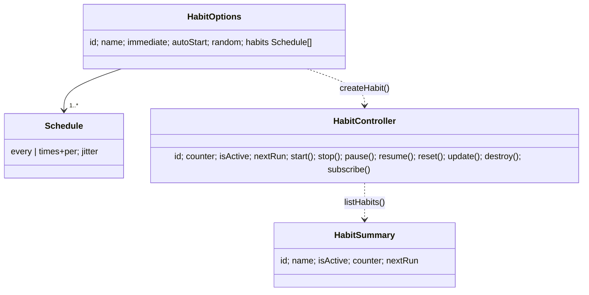

# AGENTS.md — habicron (package)

## Overview

`habicron` schedules a callback on randomized recurring intervals ("habits"): evenly spaced by default, optionally jittered
with no long-run drift. One framework-agnostic engine (`src/core`) with entry points `node` (default), `browser`, `vue`, `react`
and a `habit` CLI binary. Published package (repo `imrim12/habicron`, version in `package.json`), built with unbuild to `dist/`
(ESM + CJS + `.d.ts`); never remove the build or add a root `index.js`. Consumed in the ecosystem by `apps/webhook/habicron`
(`workspace:*`).

## Roles and abilities

No roles; not an ID relying party. It is a library/CLI consumed as a dependency (`import ... from 'habicron'`) or via the `habit` binary.

### Platform roles

None.

### Application roles

None.

### API Key

None; this project does not issue or accept ID API keys.

## Layout

```
src/core     engine: types + scheduler, no deps (dur, resolveJitter, normalize, longTimeout, createHabit, nextRuns, registry)
src/node     re-exports core, headless
src/browser  useHabit (callbacks)      src/vue useHabit (refs)      src/react useHabit (state)
src/cli      index.ts store.ts daemon.ts - the `habit` background task manager
skills/habicron-{node,browser,vue,react,cli}/SKILL.md   one agent skill per platform
```

## Invariants (do not break)

- One engine: all scheduling logic is in `src/core`; adapters stay thin and never reimplement `dur`/`normalize`/`longTimeout`/grid math.
- No drift: keep grid anchoring (`anchor + count*interval`); never collapse into `setTimeout(base +/- jitter)` recursion.
- Jitter cap is `0.49 * interval`; long delays go through `longTimeout`, never a bare `setTimeout`.
- The `TOKEN` duration regex alternation is longest-first on purpose (`ms|sec|min|mo|hr|s|m|h|d|w|y`).
- SSR-safe (no timers during server render); `fire()` swallows callback throws/rejections by design.
- `vue` and `react` are optional peers, externalised in the build; core and node import neither.
- Types lead the implementation; core types are the source of truth. Lint bans `as`, non-null `!` and `any` in `src`.
- Vue/React lint rules are scoped (`src/react/**`, `**/*.vue`); keep plain `.ts` out of them.

## Commands and conventions

- `pnpm lint` (oxlint), `pnpm typecheck`, `pnpm test` (no suites exist), unbuild on `prepack`.
  Run from the root with `pnpm --dir packages/habicron <script>`.
- Tests are deliberate, not blanket: add one only when it guards real behaviour; prove changes with lint, typecheck, build and a manual check.
- Recipes: add a unit = `UNIT` + `TOKEN` alternation; new option = extend `Schedule`/types in core first; new platform = `src/<name>/index.ts`
  plus build entry, exports map and skill. Touching scheduling math requires re-checking the no-drift reasoning.
- Landing/docs for the hosted product live in `apps/webhook/habicron`, not here.

## Domain model



## Relationships with other apps

- `apps/webhook/habicron` depends on it (`habicron: workspace:*`) for schedule parsing/next-run math in hosted crons.
- The `habit` CLI is standalone; `src/vue`/`src/react` adapters serve external consumers.
